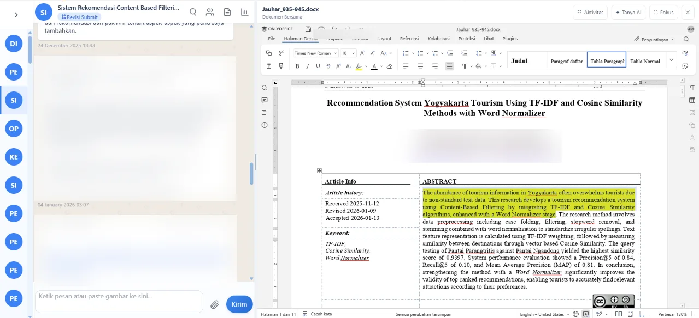
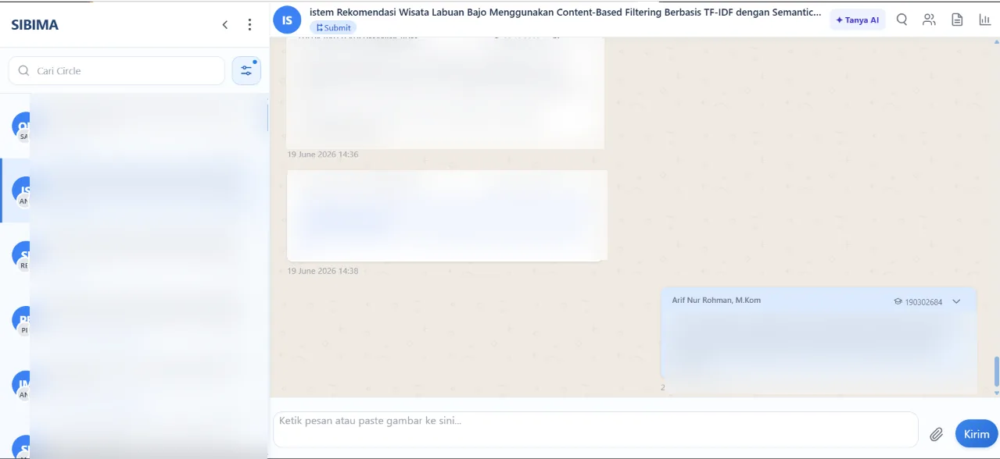
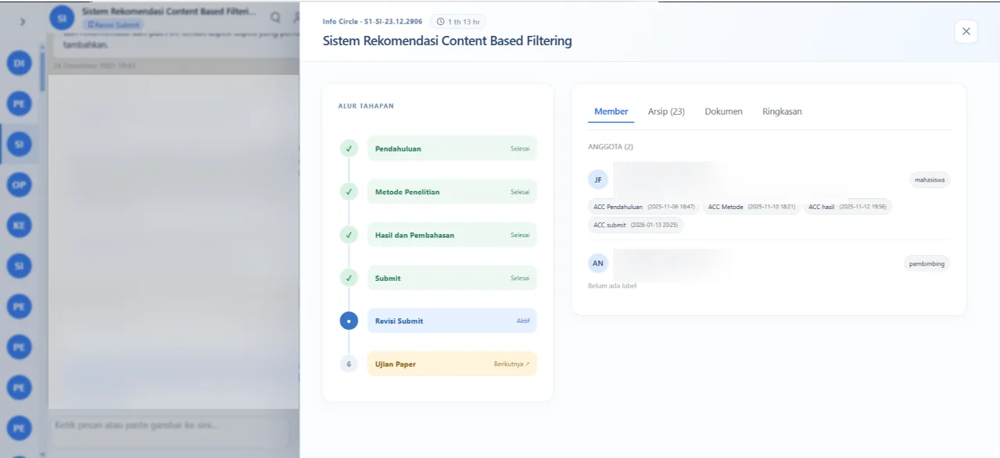
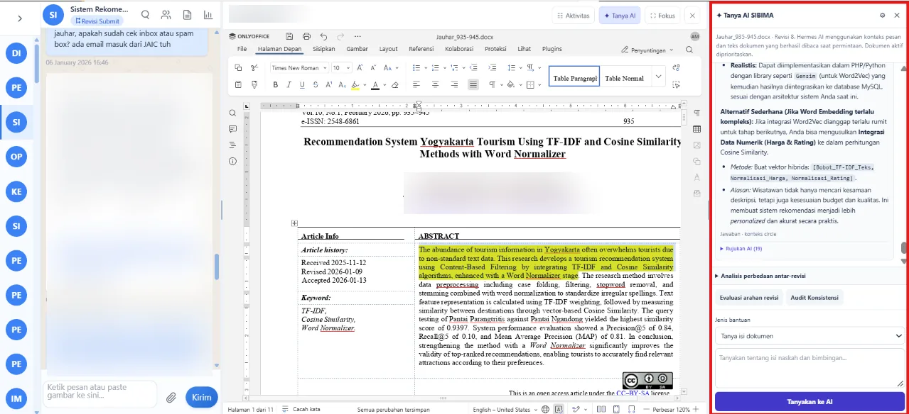
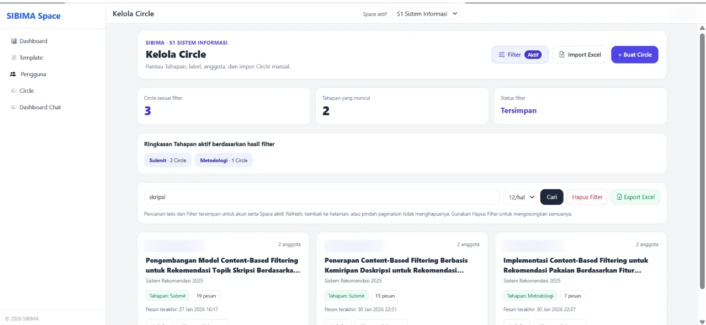
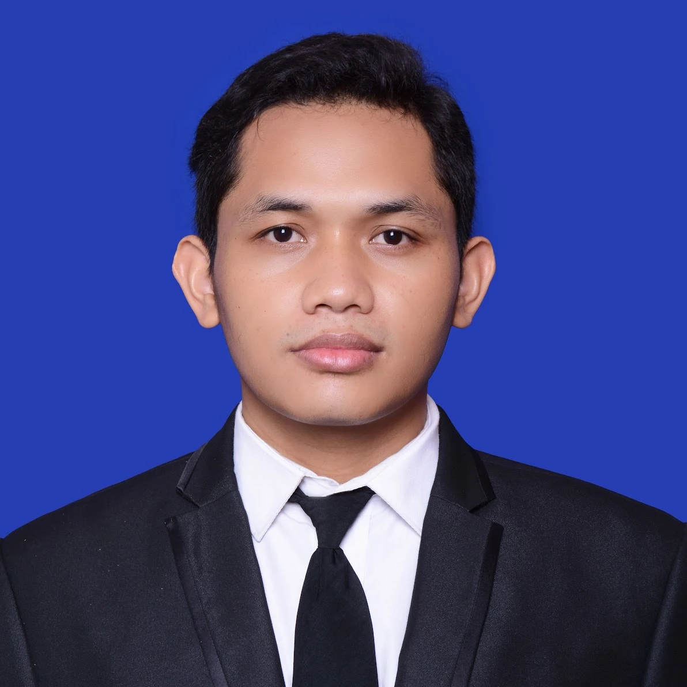

# SIBIMA

### Academic Supervision & Final Project Management Platform

**One dedicated space for academic conversations, collaborative documents, and supervision progress.**

[**Explore SIBIMA**](https://sibima.kaspedia.web.id/) · [**Schedule a Live Demo**](https://wa.me/628990423789?text=Halo%20Pak%20Arif%2C%20saya%20tertarik%20mengenal%20SIBIMA%20dan%20ingin%20mengajukan%20jadwal%20demo%20melalui%20Zoom.) · [**Bahasa Indonesia ↓**](#bahasa-indonesia)

**Built for People, Not Profit.**

---

## Why SIBIMA?

Many universities already have information systems for thesis or final project administration. But the actual supervision often happens somewhere else: conversations through WhatsApp, revisions by email, files scattered across folders, and collaborative editing in separate tools.

**SIBIMA focuses on where academic supervision actually happens.** It brings discussion, files, document editing, and supervision stages into a dedicated collaborative environment. It is designed to complement existing campus systems—not necessarily replace them.

 
Real SIBIMA interface: conversation and document editing in the same workspace. Identifying details in screenshots have been obscured.

## What can you do with SIBIMA?

| Capability | How it helps |
|---|---|
| **Real-time Circle conversations** | Keep academic discussions and shared files in a dedicated supervision space. |
| **Collaborative document editing** | Create, upload, edit, and comment on documents without leaving the workspace. |
| **Multiple document formats** | Work with DOCX, PPTX, XLSX, PDF, and CSV; editing behavior may vary by format. |
| **Supervision stages & progress** | Follow the stages of a project, review activities, and document finalization. |
| **Roles & Space administration** | Organize participants, Circles, and templates for different supervision workflows. |
| **Ask AI (pilot)** | Ask questions about document content through an AI feature currently under testing. |

### Product tour

*Screenshots show the actual SIBIMA interface. Some personal and document details are intentionally blurred for privacy.*

<strong>01 · Academic conversations in Circles</strong>

 

 
Discussions, feedback, and files stay together in the context of a particular academic group.

<strong>02 · Collaborative documents</strong>

 

 
Work on documents together while keeping the related discussion close at hand.

<strong>03 · Supervision stages</strong>

 

 
Make the supervision journey easier to follow, from initial work to review and completion.

<strong>04 · Ask AI — pilot</strong>

 

 
Explore document content with AI assistance. This feature is in **pilot/testing**; users should independently verify AI-generated answers.

<strong>05 · Space administration</strong>

 

 
Manage academic spaces, Circles, members, and supervision templates.

## Designed for academic work

SIBIMA can support different forms of ongoing academic guidance:

- Undergraduate thesis supervision (**skripsi**).
- Master's thesis and doctoral dissertation supervision (**tesis / disertasi**).
- Course-based projects that require regular mentoring and document revisions.
- Academic paper writing and other collaborative learning activities.

Both **individual lecturers** and **university departments or institutions** are welcome to request a demonstration.

## How to get started

1. [Contact the developer on WhatsApp](https://wa.me/628990423789?text=Halo%20Pak%20Arif%2C%20saya%20tertarik%20mengenal%20SIBIMA%20dan%20ingin%20mengajukan%20jadwal%20demo%20melalui%20Zoom.) to arrange a Zoom demonstration.
2. Share your supervision workflow and questions during the demo.
3. If SIBIMA fits your needs, the developer helps prepare a **Space and user accounts**.

**Current cost: Rp0.** SIBIMA is free to use at present, supported by the Project Silvanus infrastructure. This is not a guarantee that all future services will remain free.

## The story behind SIBIMA

SIBIMA grew from my own experience as a lecturer supervising students. WhatsApp makes conversations easy and responsive, but managing many versions of academic documents across repeated supervision sessions becomes increasingly difficult.

I wanted a more comfortable place for lecturers and students to focus on **sharing ideas, discussing research, and learning together**—rather than constantly managing scattered conversations and files.

**Arif Nur Rohman**  
Independent developer of SIBIMA  
Doctoral student and lecturer at Universitas Amikom Yogyakarta

SIBIMA is an **independent personal initiative**, **not an official application of any university**.

## Privacy, AI, and transparency

- User data and documents are processed for the operation of SIBIMA, not for unrelated commercial use.
- SIBIMA's document-focused AI capability runs on the Project Silvanus infrastructure and remains in pilot/testing.
- According to the developer's stated policy, user documents are **not used to train AI models**.
- Space administration includes controls for managing user information and documents. Detailed deletion, retention, and backup policies are being formalized; avoid assuming that deleting an item instantly removes every backup copy.
- Please refer to the [official SIBIMA website](https://sibima.kaspedia.web.id/) for the latest published product and privacy information.

## Support the project

SIBIMA is built to be useful, not to maximize profit. If you would like to contribute voluntarily toward a more memorable dedicated domain for SIBIMA, [please contact the developer](https://wa.me/628990423789?text=Halo%20Pak%20Arif%2C%20saya%20ingin%20mendukung%20SIBIMA%20untuk%20pengadaan%20domain%20mandiri.%20Boleh%20minta%20informasi%20donasinya%3F).

**Donations are optional and are not required to access the application.**

---

## Bahasa Indonesia

**SIBIMA — Platform Kolaborasi dan Manajemen Bimbingan Akademik**

SIBIMA adalah **sistem informasi tugas akhir** dan ruang kolaborasi akademik yang membantu dosen serta mahasiswa menjalankan bimbingan skripsi, tesis, disertasi, dan proyek mata kuliah dalam satu tempat.

Berbeda dengan sistem administrasi yang terutama mendata mahasiswa dan pembimbing, SIBIMA berfokus pada **aktivitas bimbingan yang sesungguhnya**: percakapan realtime, pengiriman berkas, penyuntingan dan komentar pada dokumen bersama, riwayat diskusi, serta pengelolaan tahapan dan progres. SIBIMA juga menyediakan fitur **Tanya AI** yang masih dalam tahap pilot.

SIBIMA dapat melengkapi sistem informasi skripsi atau sistem manajemen tugas akhir yang telah dimiliki perguruan tinggi. Tidak harus menggantikan sistem kampus yang sudah berjalan.

**Cara mencoba:** hubungi pengembang melalui [WhatsApp untuk menjadwalkan demo Zoom](https://wa.me/628990423789?text=Halo%20Pak%20Arif%2C%20saya%20tertarik%20mengenal%20SIBIMA%20dan%20ingin%20mengajukan%20jadwal%20demo%20melalui%20Zoom.). Setelah diskusi, pengembang dapat membantu menyiapkan Space dan akun pengguna.

**Biaya saat ini: Rp0**, berkat dukungan infrastruktur Project Silvanus. Penggunaan gratis saat ini tidak otomatis berarti gratis selamanya.

SIBIMA dikembangkan secara independen oleh **Arif Nur Rohman**, mahasiswa doktoral dan dosen Universitas Amikom Yogyakarta. **SIBIMA bukan aplikasi resmi perguruan tinggi mana pun.**

*Built for People, Not Profit.*

## About this repository

**This is a public information and product showcase repository, not an open-source distribution.** It includes product descriptions and visual assets only.

- The SIBIMA application source code, deployment configuration, and private infrastructure details are **not published here**.
- No open-source license is granted for SIBIMA's application code through this repository.
- For product access, demonstrations, or inquiries, use the official links below.

**Website:** https://sibima.kaspedia.web.id/  
**Live demo:** [Request via WhatsApp](https://wa.me/628990423789?text=Halo%20Pak%20Arif%2C%20saya%20tertarik%20mengenal%20SIBIMA%20dan%20ingin%20mengajukan%20jadwal%20demo%20melalui%20Zoom.)

---

<strong>SIBIMA · Built for People, Not Profit.</strong>

